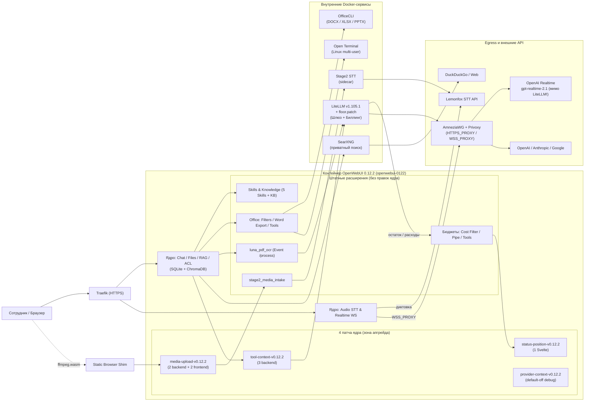

# Карта архитектуры и воркфлоу (`corp-openweb-ui`)

Актуальный срез: **OpenWebUI 0.12.2** (`gpt.alpha-soft.ru`).

> **Интерактивная карта на одном листе:** [открыть в браузере (GitHub Pages)](https://kwentin3.github.io/corp-openweb-ui/architecture-map.html) или локально [`docs/architecture-map.html`](architecture-map.html) — там можно переключать 5 потоков данных, подсвечивать зону патчей перед апгрейдом и кликать по любому узлу, чтобы увидеть точные пути в репозитории и границы с ядром.

Проект построен по принципу **extension-first**: вместо глубокого форка OpenWebUI поверх ванильного `0.12.2` применяются всего **4 узких патча ядра** (плюс **1 патч в LiteLLM**), а вся остальная корпоративная логика вынесена в штатные расширения OpenWebUI и соседние Docker-сервисы.

## Общая схема на одном листе

## 5 ключевых потоков данных (воркфлоу)

| Воркфлоу | Как идут данные | Ключевые файлы |
| --- | --- | --- |
| **1. Чат + Бюджеты** | `Пользователь → Traefik → OpenWebUI [tool-context] → LiteLLM (auth + floor.patch) → Proxy → LLM → Cost Filter.outlet (читает остаток из LiteLLM) → [status-position] → строка «Ответ · Чат · Остаток»` | [`deploy/openwebui-budgets/`](../deploy/openwebui-budgets), [`compose/openwebui.employee-budgets.compose.yml`](../compose/openwebui.employee-budgets.compose.yml), [`docs/infra-ops/employee-budgets-goal584.md`](infra-ops/employee-budgets-goal584.md) |
| **2. Офис и корп-шаблоны** | `Запрос + файл → Skills (artifact-workflow / corporate-template) + Knowledge → officecli_auto_attach_filter → OfficeCLI (DOCX/XLSX/PPTX) или Open Terminal (terminal_file_transfer) → готовый файл вложением` | [`services/officecli-openapi-proof/`](../services/officecli-openapi-proof), [`deploy/openwebui-tools/`](../deploy/openwebui-tools), [`docs/infra-ops/officecli-openapi-docx-release.md`](infra-ops/officecli-openapi-docx-release.md) |
| **3. PDF OCR (Luna)** | `Загрузка PDF → OpenWebUI Files → External Document Extraction → Event Function luna_pdf_ocr (/process) → native Responses (gpt-6-luna) → текст в штатный File/RAG кэш` | [`deploy/openwebui-functions/luna_pdf_ocr.py`](../deploy/openwebui-functions/luna_pdf_ocr.py), [`docs/infra-ops/luna-ocr.md`](infra-ops/luna-ocr.md) |
| **4. Голос и аудио (3 пути)** | **A (Файлы):** `media-upload → stage2_media_intake → stage2-stt → Lemonfox`. **B (Микрофон):** `Audio STT → Lemonfox` (мимо sidecar). **C (Realtime):** `Voice Mode WS → WSS_PROXY → OpenAI gpt-realtime-2.1` *(мимо LiteLLM-бюджетов!)* | [`services/stage2-stt/`](../services/stage2-stt), [`docs/infra-ops/microphone-stt.md`](infra-ops/microphone-stt.md), [`docs/infra-ops/realtime-voice.md`](infra-ops/realtime-voice.md) |
| **5. Веб-поиск** | `Чат / Realtime handoff → native web_search (по умолчанию на 14 моделях) → приватный SearXNG → DuckDuckGo → контекст модели` | [`compose/searxng.private.compose.yml`](../compose/searxng.private.compose.yml), [`docs/infra-ops/web-search-defaults.md`](infra-ops/web-search-defaults.md) |

## Зона апгрейда (все патчи ядра)

Полные условия снятия и хэши ведутся в [`docs/infra-ops/patch-registry.md`](infra-ops/patch-registry.md).

1. **OpenWebUI `tool-context-v0.12.2`** (3 backend-файла) — reasoning/картинки из tool-results и проекция длинных call/result ID (>64 символов).
2. **OpenWebUI `media-upload-v0.12.2`** (2 backend + 2 frontend-файла) — лимит вложений на сообщение и same-ID handoff подготовки медиа.
3. **OpenWebUI `status-position-v0.12.2`** (1 Svelte-файл) — позиция статуса `after_content` под ответом.
4. **OpenWebUI `provider-context-v0.12.2`** (1 router seam, выключен по умолчанию) — операторская запись финального JSON-запроса к провайдеру.
5. **LiteLLM `positive-floor-v1.105.1`** (`floor.patch`) — защита месячного сброса счётчика от старого cached DB floor.

## Что на хосте и что заморожено

- **Хост:** `Flight Recorder` (`deploy/openwebui-flight-recorder/`, systemd-самописец 5 контейнеров), `AmneziaWG + Privoxy` (`deploy/transport/`), CI `active-ci` (`.github/workflows/active-ci.yml`).
- **Не в проде (отдельные контуры в репе):** `services/broker-reports-gate1-proof/` (замороженный контур Broker Reports / НДФЛ / XML, ручной `broker-reports-ci.yml`) и `deploy/hermes-corporate-v1/` (отдельный задел).

## Контракт актуализации карты

Карта поддерживается в актуальном состоянии как часть PR (см. также корневой [`AGENTS.md`](../AGENTS.md)).

### Когда обновлять
- **Обязательно:** добавлен/снят патч ядра (`deploy/openwebui-patches/`, `deploy/litellm-patches/`), добавлен/удалён Docker-сервис (`compose/`, `services/`), добавлена/перенесена точка расширения OpenWebUI (`deploy/openwebui-*`), либо изменился маршрут данных (воркфлоу, egress/прокси, контур биллинга).
- **Не обновлять:** обычные багфиксы, тесты, внутренние рефакторинги без смены границ, коммерческие предложения и разовые отчёты.

### Чек-лист для кодового агента
1. В [`docs/architecture-map.html`](architecture-map.html) обновить три места согласованно:
   - DOM-карточку узла (`id="node-<id>"`, `data-id="<id>"`, категория `cat-core` / `cat-patch` / `cat-ext` / `cat-svc` / `cat-infra` / `cat-frozen`);
   - описание узла в объекте `NODES` (включая реальные относительные пути в `paths`);
   - затронутые маршруты в `WORKFLOWS` (и вкладку `patches`, если менялась зона апгрейда).
2. Синхронизировать Mermaid-схему, таблицу потоков и список патчей в [`docs/ARCHITECTURE_MAP.md`](ARCHITECTURE_MAP.md).
3. Проверить перед коммитом, что:
   - все пути в `NODES.*.paths` реально существуют в репозитории;
   - все `from`/`to` в `WORKFLOWS` соответствуют существующим `id="node-..."`;
   - `<script>` в `docs/architecture-map.html` не содержит синтаксических ошибок JS.
4. После слияния PR в `main` workflow [`.github/workflows/pages-architecture-map.yml`](../.github/workflows/pages-architecture-map.yml) автоматически перепубликует `docs/architecture-map.html` на GitHub Pages.
